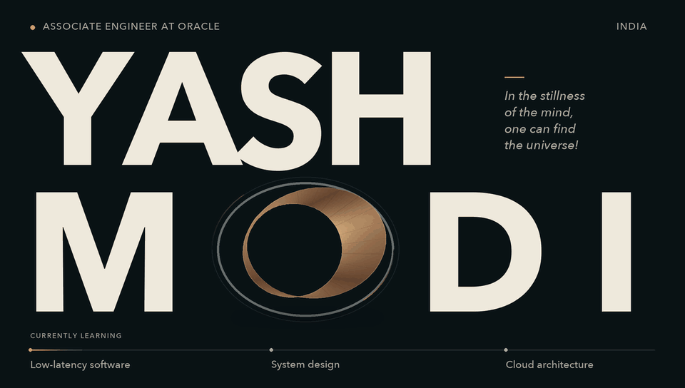
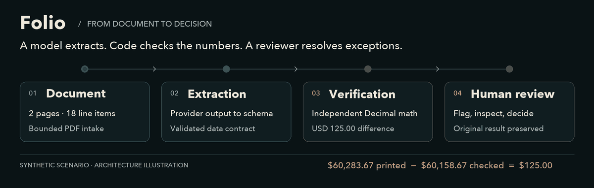
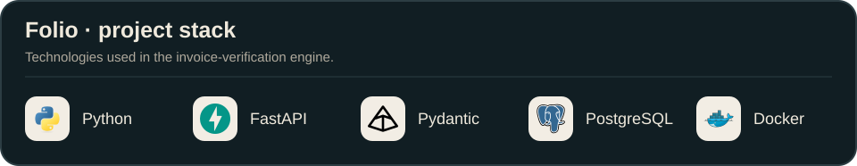
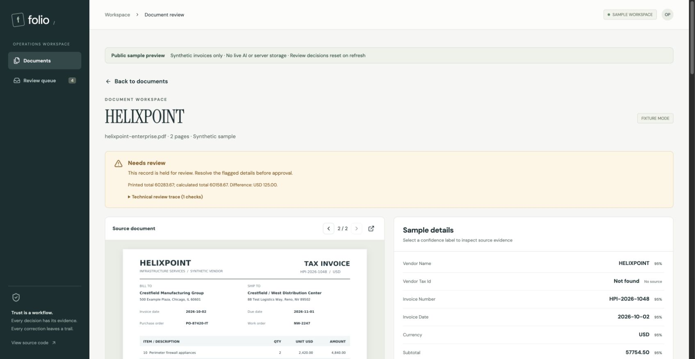
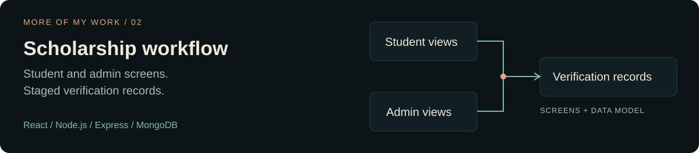
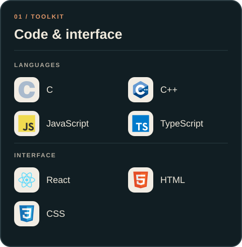
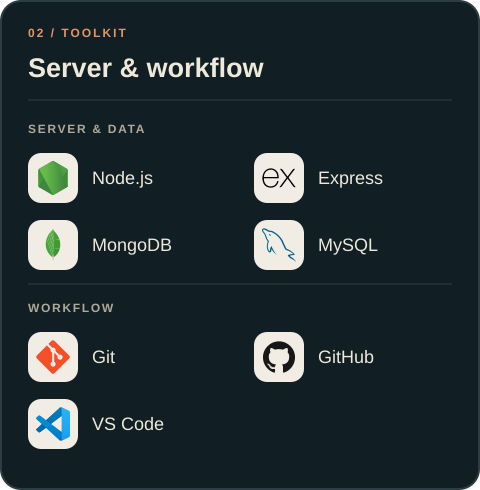

<picture>
  <source media="(prefers-reduced-motion: reduce)" srcset="https://raw.githubusercontent.com/YashModi1804/YashModi1804/2097a7530c36a8f57bd8f8b742573db69aca2b33/assets/identity-dark.png">
  
</picture>

I'm **Yash Modi**, an **Associate Engineer at Oracle** and a developer from **India**. I build **full-stack software and AI integrations**, with a focus on clear workflows, independent validation, and traceable decisions.

## Selected work

### Folio · AI invoice processing & verification

From invoice PDFs to structured records—with arithmetic checked independently of the model, source evidence for reviewers, and a history that keeps the original extraction intact.

<a href="https://github.com/YashModi1804/folio-invoice-verification#how-it-works">
  <picture>
    <source media="(max-width: 600px)" srcset="https://raw.githubusercontent.com/YashModi1804/YashModi1804/2097a7530c36a8f57bd8f8b742573db69aca2b33/assets/folio-pipeline-mobile.svg">
    <source media="(prefers-reduced-motion: reduce)" srcset="https://raw.githubusercontent.com/YashModi1804/YashModi1804/2097a7530c36a8f57bd8f8b742573db69aca2b33/assets/folio-pipeline.png">
    
  </picture>
</a>

**Three decisions you can inspect in the code:**

- **Verify the output.** [Decimal arithmetic](https://github.com/YashModi1804/folio-invoice-verification/blob/main/app/domain/verify.py) checks line items and totals; missing values never silently become zero.
- **Make failure explicit.** A [database-backed worker](https://github.com/YashModi1804/folio-invoice-verification/blob/main/app/worker.py) processes persisted jobs with explicit processing and failure states.
- **Keep the evidence.** [Review decisions](https://github.com/YashModi1804/folio-invoice-verification/blob/main/app/review.py) preserve the original extraction alongside the corrected result.

<picture>
  <source media="(max-width: 600px)" srcset="https://raw.githubusercontent.com/YashModi1804/YashModi1804/2097a7530c36a8f57bd8f8b742573db69aca2b33/assets/toolkit-project-mobile.svg">
  
</picture>

**[Explore the sample walkthrough ↗](https://yashmodi1804.github.io/folio-invoice-verification/)** · **[Source code](https://github.com/YashModi1804/folio-invoice-verification)** · **[Try the live demo](https://yashmodi1804.github.io/folio-invoice-verification/launch/)**

The screenshot and walkthrough use labeled synthetic fixtures. The live demo uses a temporary free backend and may need time to wake.

  

### Scholarship workflow

A **React / Express / MongoDB** scholarship portal with student and administrative screens and staged verification records.

**[Explore the source ↗](https://github.com/YashModi1804/RBAC-Driven-Scholarship-Workflow-Engine)** · [Frontend routes](https://github.com/YashModi1804/RBAC-Driven-Scholarship-Workflow-Engine/blob/main/frontend/src/App.js) · [Verification model](https://github.com/YashModi1804/RBAC-Driven-Scholarship-Workflow-Engine/blob/main/backend/models/scholarshipDetails.js)

## My working toolkit

  
Toolkit as text

**Languages:** C, C++, JavaScript, TypeScript. **Interface:** React, HTML, CSS.
**Backend:** Node.js, Express. **Data:** MongoDB, MySQL.
**Workflow:** Git, GitHub, VS Code.

## What I'm exploring next

I'm learning **low-latency software**, **system design**, and **cloud architecture**. I'm always up for a conversation about **C++**, **Node.js**, **React**, **REST APIs**, or whatever you're building.

> In the stillness of the mind, one can find the universe!

  
<b>GitHub activity</b> — contributions, streaks & languages

   
  

  A dated weekly snapshot from GitHub's public profile and repository data.
  Contributions are not commit counts. Streaks cover the displayed 365-day window;
  language shares measure source bytes in original public repositories, excluding HTML.

  [Snapshot & sources](./data/activity.json) · [How it updates](./design/MAINTENANCE.md)

  Original views: [Profile stats](https://github-readme-stats-salesp07.vercel.app/api?username=YashModi1804&count_private=true&show_icons=true&theme=react&rank_icon=github&border_radius=10) · [Streaks](https://github-readme-streak-stats-salesp07.vercel.app/?user=YashModi1804&count_private=true&theme=react&border_radius=10) · [Top languages](https://github-readme-stats-salesp07.vercel.app/api/top-langs/?username=YashModi1804&hide=HTML&langs_count=8&layout=compact&theme=react&border_radius=10&size_weight=0.5&count_weight=0.5&exclude_repo=github-readme-stats)

 

