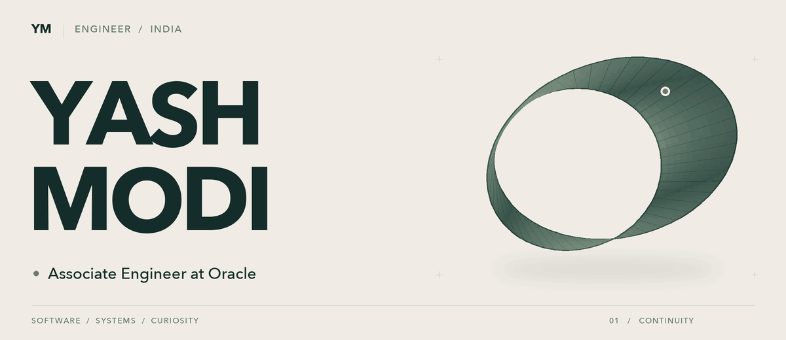
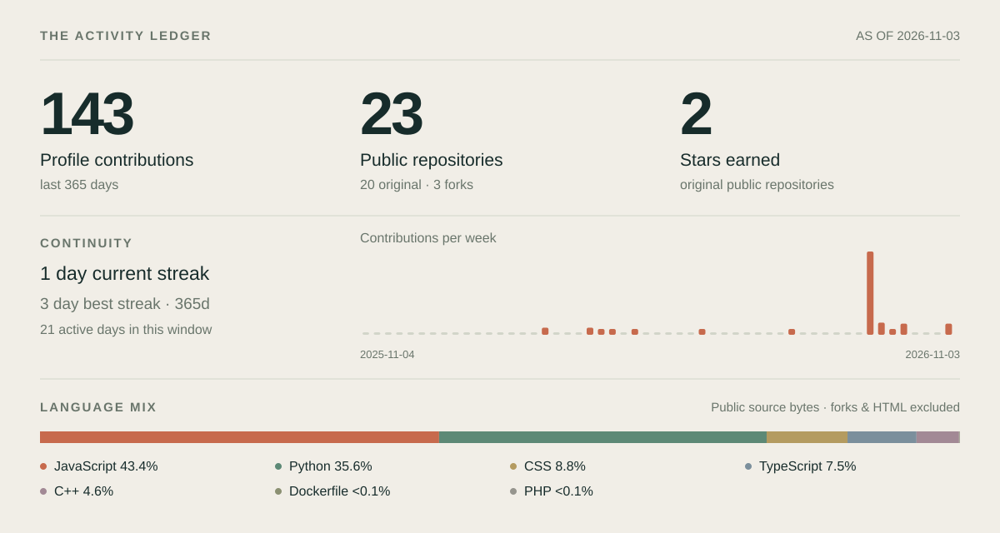

<picture>
  <source media="(prefers-reduced-motion: reduce) and (prefers-color-scheme: dark)" srcset="./assets/identity-dark.png">
  <source media="(prefers-reduced-motion: reduce)" srcset="./assets/identity-light.png">
  <source media="(prefers-color-scheme: dark)" srcset="./assets/identity-dark.gif">
  
</picture>

 

I’m **Yash Modi**, an **Associate Engineer at Oracle** and a passionate developer from India.

Currently learning **low-latency software**, **system design**, and **cloud architecture**.

I’m always up for a conversation about **C++**, **Node.js**, **React**, **REST APIs**—or whatever you’re curious about.

**[Say hello ↗](mailto:modi.yash18042004@gmail.com)** &nbsp; / &nbsp; **[LinkedIn ↗](https://www.linkedin.com/in/yash-modi-1804y/)** &nbsp; / &nbsp; **[Ask me something ↗](https://github.com/YashModi1804/YashModi1804/issues)**

 

### The working set

| | Languages, frameworks & tools |
| :--- | :--- |
| **Languages** | C · C++ · JavaScript · TypeScript |
| **Interface** | React · HTML · CSS |
| **Backend** | Node.js · Express |
| **Data** | MongoDB · MySQL |
| **Workflow** | Git · GitHub · VS Code |

 

### Beyond the code

> In the stillness of the mind, one can find the universe!

 

  
<b>The activity ledger</b> — contributions, streaks & languages

   
  <picture>
    <source media="(prefers-color-scheme: dark)" srcset="./assets/activity-dark.svg">
    
  </picture>

  A weekly snapshot from GitHub’s public profile and repository data. Contributions
  include the anonymized activity GitHub displays publicly; they are not a count
  of commits. Streaks cover the displayed 365-day window. Language shares use source
  bytes from original public repositories, with HTML excluded.

  [Snapshot & sources](./data/activity.json) · [How it updates](./design/MAINTENANCE.md)

 

  A study in continuity. <a href="./assets/identity-light.png">View the still artwork</a>.
   
  

